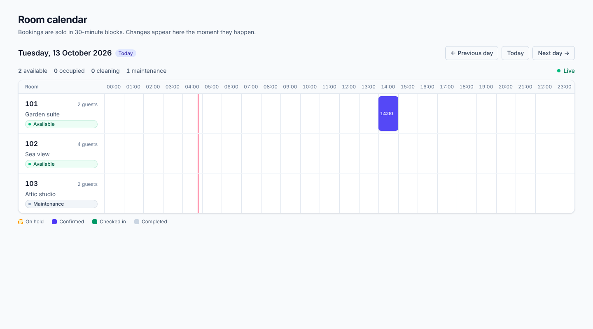

# hotel-mvp-frontend

Real-time room calendar for the hotel booking system sold in **30-minute blocks**.
Next.js (App Router, React Server Components) + TypeScript (strict) + Tailwind CSS 4.
The API lives in its own repository, **hotel-mvp-backend**.



## What it does

* **First paint comes from the server.** A Server Component reads the day's rooms and
  bookings from the backend and sends them rendered in the HTML: no loading spinner, no
  client-side fetch waterfall.
* **Then it stays alive.** The browser opens one WebSocket; when a room changes status
  (`available`, `occupied`, `cleaning`, `maintenance`) or a booking is held, confirmed,
  cancelled, completed or expires, the board updates by itself, without a reload.
* **It heals itself.** After a dropped connection the socket reconnects with exponential
  backoff and the page reloads the snapshot, so changes missed while offline appear.

## Prerequisites

* Node.js **22 LTS** (>= 20.9) and npm
* A running backend (`hotel-mvp-backend`): REST on `:8000` and the WebSocket
  `/ws/events`. The backend's `CORS_ORIGINS` must include this app's origin, because the
  WebSocket handshake is checked against it.

## Configuration (12-Factor)

Server-side variables, read **at request time**: one build runs in any environment.
Copy `.env.example` to `.env.local` for local development.

| Variable | Default | Purpose |
|---|---|---|
| `API_BASE_URL` | `http://localhost:8000` | Where the Next.js *server* calls the REST API (in Docker: the service name). |
| `WS_URL` | `ws://localhost:8000/ws/events` | Where the *browser* opens the WebSocket (the API's public address). |
| `HOTEL_TIMEZONE` | `UTC` | IANA zone that decides where a day starts and how times are shown. |

An invalid value fails fast with a message naming the variable.

## Commands

```bash
npm install
cp .env.example .env.local
npm run dev            # http://localhost:3000

npm run check          # lint + typecheck + tests (what CI should run)
npm run lint
npm run typecheck      # next typegen && tsc --noEmit
npm test               # vitest, single run
npm run test:watch

npm run build && npm start
```

### Docker

```bash
docker compose up --build        # web on http://localhost:3000, backend must already run
```

The image is multi-stage, runs as a non-root user from the `standalone` output and exposes
`GET /api/health` (liveness only: it does not call the backend).

## Architecture: Feature-Sliced Design

`app/` is the Next.js routing layer and stays thin. All code lives in `src/`, organised in
layers that may only import from layers **below** them. ESLint enforces it
(`eslint.config.mjs`).

```
app/                          routes only: layout, page, error, health
src/
  shared/                     no business knowledge
    api/                      fetchJson: timeout, no-store, zod validation, one ApiError type
    config/                   server-env: runtime config validated with zod (server-only)
    lib/                      useWebSocket, useNow, time-zone helpers
  entities/                   business objects
    room/                     status model + <RoomStatusBadge>
    booking/                  status model, forward-only rank, <BookingBlock>
  features/
    live-calendar/            snapshot + live events: schemas, reducer, <CalendarProvider>
  widgets/
    calendar-board/           the board: time axis, room rows, connection badge
  views/                      (FSD "pages" layer, renamed: Next reserves `pages/`)
    calendar/                 <CalendarView> Server Component, day navigation, skeleton
tests/                        shared test helpers (fake WebSocket, fixtures)
```

Rules enforced by lint: a layer never imports from a higher one, and a slice is used only
through its public API (`index.ts`, or `server.ts` for code that must never reach a client
bundle). Tests live next to the code they cover.

## How data flows

```
 Server (per request)                              Browser
 ────────────────────                              ───────
 <CalendarView> (RSC)
   read ?date, env, clock
   GET /api/v1/calendar ──► snapshot ──► <CalendarProvider initial=…>   (client)
                                          │  useReducer(calendarReducer)
                                          │  useWebSocket(WS_URL) ◄── ws /ws/events
                                          ▼
                                       <CalendarBoard>   rooms re-render individually
```

* **Server Component** (`views/calendar`): the only place that talks to the REST API.
  It runs inside `<Suspense>` because it depends on the request (query string, environment,
  wall clock); the static shell (title, skeleton) is prerendered (Partial Prerender).
* **`useWebSocket`** (`shared/lib`): reconnection with exponential backoff + jitter,
  immediate retry when the browser goes back online, handlers kept in refs so inline
  callbacks never tear the socket down, clean teardown on unmount.
* **`CalendarProvider`** (`features/live-calendar`): one context for the data, another for
  the connection status, so socket flaps do not re-render the board. A newer server snapshot
  (navigation, `router.refresh()`) replaces local state.
* **Reducer rules** (pure, unit-tested):
  * a late event never moves a booking backwards (`hold_created` after `confirmed`);
  * out-of-order room status events: the newest `occurred_at` wins;
  * duplicates change nothing and keep object identity, so only the affected room row
    re-renders;
  * cancelled / expired bookings are removed, events outside the visible day are ignored;
  * unknown or malformed messages are dropped (the socket is untrusted input).
* **Resynchronisation:** `system.resync` from the server, or any reconnection, triggers
  `router.refresh()`: the Server Component re-reads the snapshot and the board adopts it
  without dropping the socket.
* **Holds:** a pending booking whose 5-minute deadline passed is hidden by the clock even
  before the server announces its expiry.

### Message contract

REST `GET /api/v1/calendar` and WebSocket frames are validated with zod at the boundary
(`features/live-calendar/model/snapshot.ts`, `live-events.ts`). The envelope is
`{ v: 1, type, occurred_at, room_id, data }`; types: `booking.hold_created | confirmed |
cancelled | completed | expired`, `room.status_changed`, `system.connected`,
`system.resync`. See the backend README for the catalogue.

## Time zones

A day is the hotel's local day (`HOTEL_TIMEZONE`): 23 or 25 hours on daylight-saving
changes, handled by `@date-fns/tz`. Instants travel as ISO-8601 and are formatted in that
zone on both server and client, so there are no hydration mismatches.

## Testing

`npm test` runs 140+ tests with Vitest + Testing Library:

* time-zone maths, including DST days and a zone whose midnight does not exist;
* `useWebSocket` (backoff, jitter, reconnect flag, cleanup, `online` event);
* event parsing and the reducer;
* the board end to end with a fake WebSocket: status changes, booking life cycle,
  connection badge, resync, snapshot adoption;
* the Server Component: fetched window per time zone, `?date` handling, API failures.

Beyond unit tests, the whole stack was also verified in a real browser (Chromium) against
the real backend: live hold / confirm / cancel / room cleaning, a refused overlapping
booking, backend killed and restarted with a change made while offline, day navigation,
dark mode and a 390 px viewport.

## Notes and limitations

* No authentication yet; the calendar shows occupancy only and never guest data.
* The board shows one day at a time (`?date=YYYY-MM-DD`).
* Rooms are read-only here; the cleaning action (`POST /api/v1/rooms/{id}/cleaned`) is an
  API endpoint without UI yet.
